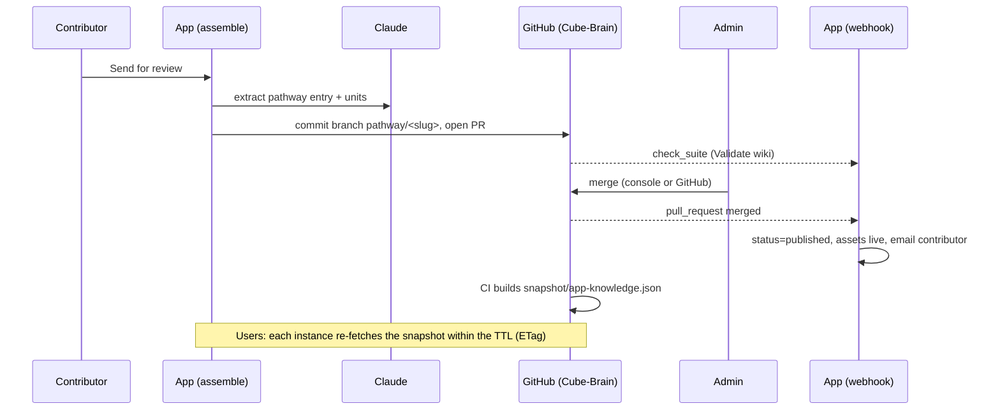

# Plan: Cube-Brain as the Knowledge Source

> Status: **Approved 2026-10-30** (architecture-plan). Inputs: [requirement](requirement_cube_brain_knowledge_source.md), [business clarifications](business_clarifications_cube_brain_knowledge_source.md), [architecture clarifications](architecture_clarifications_cube_brain_knowledge_source.md).

The user-facing flow charts are in [`requirement_cube_brain_knowledge_source.md`](requirement_cube_brain_knowledge_source.md) → "Flow charts".

## Summary

> **Must-have retrieval capabilities (added 2026-10-30, business Q18).** The design must deliver all three:
> 1. Cube must accurately retrieve specific information from individual pathways based on understood user intent.
> 2. Cube must retrieve relevant answers across multiple pathways for broader user queries.
> 3. Cube must identify and synthesize common patterns across multiple pathways for advanced insights.
>
> The retrieval section below is designed around them, and the CB-11 test set checks each one.

Cube-Brain (`anurag14-10/Cube-Brain`) becomes the source of all pathway knowledge in the app:

- **Reading.** The app reads a published-only snapshot of the brain at runtime, fetched from GitHub with a Supabase fallback copy.
- **Retrieval.** Instead of injecting the whole corpus every turn, it first selects the pathways relevant to the conversation, then grounds the answer on their micro-innovation units and the top documents.
- **Send for review** becomes a brain pull request carrying the document, the pathway entry and Claude-extracted units.
- **Publishing.** An admin merging that PR, from the console or on GitHub, is what publishes.

Supabase keeps app data, plus the last good snapshot.

## Scope

**In scope:**
- **Brain:**
  - schema v3: a `documents/` folder and a `card_hook` field, with migrator and validator
  - catch-up content: the 10 live pathways' documents and hooks, the 2 missing pathways, the 2 stale pathways, link fixes
  - snapshot builder, run by CI on `main` and `dev`
  - a `dev` branch, a private repo, branch protection
- **App read path:**
  - the snapshot reader
  - every corpus read site switched to the brain behind `KNOWLEDGE_SOURCE`
  - the retriever
- **App write path:**
  - extraction plus PR on assemble
  - merge on publish
  - Decline
  - the GitHub webhook
  - Resync
- **Admin console:** PR link, validation state, Decline, Resync. Contributor status from PR state.

**Out of scope:**
- the Claude Chat channel
- moving `content/framework.md`
- moving toolkit asset files
- a console button to retire a pathway
- removing the legacy path (`content/wiki/pathways/`, `lib/library-pathways.ts`, `published_pathways` reads, the diffusion-cube commit in assemble), which is follow-up work once the test set passes

## Assumptions

- Snapshot TTL is **5 minutes** (`BRAIN_SNAPSHOT_TTL_SECONDS`, default 300).
- The selection call uses **`claude-sonnet-4-6`**, matching the one-model-everywhere convention. Haiku 5.5 was offered as a cheaper and faster option (see Risks & Open Items); it was not chosen at approval.
- The selection picks **at most 3** pathways. Full documents are sent only for the **top 2**.
- If the selection call fails, the turn falls back to the whole published corpus from the snapshot (today's behaviour), never a false "nothing matches".
- Each extracted unit's slug is `<pathway-slug>-<short-kebab-title>`, checked unique against the snapshot.

## Affected Areas

| Area | Component(s) | Nature of change |
|---|---|---|
| Brain repo | `SCHEMA.yml`, `CONVENTIONS.md`, `MASTERS.md`, `scripts/validate_wiki.py`, new `scripts/migrate_v2_to_v3.py`, new `scripts/build_app_snapshot.py`, `.github/workflows/validate.yml` (also on `dev`; builds and commits `snapshot/app-knowledge.json`), new `documents/<slug>.md` ×10, `pathways/*.md` (`card_hook`, catch-up) | schema v3 + snapshot + content |
| Data | `supabase/migrations/0042_brain_knowledge_source.sql` | new tables `brain_snapshots`, `knowledge_selections`; new `pathways` columns for PR and validation state |
| Domain logic (new) | `lib/brain/snapshot.ts` (fetch + ETag + TTL + DB fallback), `lib/brain/corpus.ts` (published-only accessors, Source Trace stripping, card mapping), `lib/brain/retrieve.ts` (selection + grounding block), `lib/brain/extract.ts` (document → pathway entry + units), `lib/brain/entries.ts` (render brain markdown; values written as JSON, which is valid YAML, so no new dependency) | new modules |
| GitHub integration | `lib/github.ts`: brain requests with a fine-grained token (`BRAIN_GITHUB_TOKEN`, PAT: changed from a GitHub App 2026-10-30), multi-file commit on a branch (Git Data API), open/update/merge/close PR, read the snapshot file | extended, plus new env vars |
| Corpus read sites | `lib/wiki-loader.ts` (`loadWikiContext`, `curatedPathwaySlugs`/`isReservedPathwaySlug`), `lib/library-documents.ts`, `lib/wiki-content.ts`, `app/explore/page.tsx` + `ExploreLibrary.tsx`, `app/api/wiki-pathways`, `app/api/wiki-stats`, `app/api/pathways/check-similar/route.ts`, `app/api/pathways/route.ts` (Published badge), `app/admin/page.tsx` | branch on `KNOWLEDGE_SOURCE` |
| Chat | `app/api/chat/route.ts`: retrieval for `companion` (both flows), `analysis-doc`, `executive-summary`, and the library overview; per-pathway library document from the snapshot. `lib/system-prompts.ts`: grounding-block wording (selected pathways, units, absence rules) | modified |
| Routes | `app/api/pathways/assemble/route.ts` (extract → PR), `app/api/admin/pathways/publish/route.ts` (merge PR; the contributor email moves to the merge handler), new `app/api/admin/pathways/decline/route.ts`, new `app/api/admin/brain/resync/route.ts`, new `app/api/brain/webhook/route.ts` (HMAC-verified; `pull_request`, `check_suite`, `push`) | new + modified, all through `withErrorHandling` |
| Middleware | `proxy.ts`: add `/api/brain/webhook` to the public allow-list | config |
| Frontend | `components/AdminPathwaysPanel.tsx` / `AdminPathwayRowCard.tsx` (PR link, validation badge, Decline, Resync); contributor status text in the Contribute workspace ("awaiting review" from PR state) | modified |
| Config | `BRAIN_REPO`, `BRAIN_BRANCH`, `BRAIN_SNAPSHOT_PATH`, `BRAIN_SNAPSHOT_TTL_SECONDS`, `BRAIN_GITHUB_TOKEN`, `GITHUB_WEBHOOK_SECRET`, `KNOWLEDGE_SOURCE` | new env vars; `architecture/configuration.md` in the wiki to refresh |

## Architectural Approach

**Read path.**
- **Snapshot.** Brain CI runs `build_app_snapshot.py` on every push to `main`/`dev`. It writes one JSON file containing only what the app may use:
  - published pathways (entry fields, `card_hook`, full document)
  - their units and patterns
  - the organisations they name

  People, decisions, risks, milestones and unpublished or retired entries are excluded at build time.
- **Fetching.** `lib/brain/snapshot.ts` fetches the file with `BRAIN_GITHUB_TOKEN` (raw media type, so there is no 1 MB Contents API limit), with `If-None-Match`, at most once per TTL per server instance. A new commit is parsed once, held in memory, and written to `brain_snapshots` as the last good copy. Any fetch failure, or a cold start that can't reach GitHub, serves the saved copy.
- **Filtering.** The app filters `lifecycle == published` again (defence in depth), so a bad build can never leak a draft.
- **Version check.** The app refuses a snapshot whose major `schema_version` it doesn't know, and keeps the last good copy.

**Retrieval.**
- **Selection** (*intent-aware, updated 2026-10-30 for the three must-have capabilities*). `lib/brain/retrieve.ts` sends one forced-tool-use call (`select_pathways`, reusing the `check-similar` pattern) on **every new user message**. Its input is the catalogue (slug, title, sector, `use_case_category`, geography, stage, summary, and the names of the pathway's micro-innovations, so details below the summary are findable) plus recent turns and `meta`. It returns:
  - a `query_type`;
  - ranked slugs;
  - optionally the dimensions and stages the question is about.

  | `query_type` | Meaning | Pathways | Grounding block |
  |---|---|---|---|
  | `specific` | Asks about a named or identified pathway | ≤2, any sector | Their full documents, then their units (capability 1) |
  | `situation` | The person's own adoption | ≤3, same sector AND same problem | Full documents of the top 2, units for the cells in focus first (as before) |
  | `broad` | A question across pathways | ≤6, any sector | Units on the topic (focus dimensions and stages first) from every selected pathway, each labelled with its pathway and sector; full document of the top 1 (capability 2) |
  | `patterns` | Common patterns | ≤6, any sector, a one-pathway finding kept (called "a single example") | The top pathway's full document; the brain's Problem-Solution Patterns spanning the selected pathways first, then units sharing a dimension and stage across ≥2 of them, with synthesis instructions: name the pathways behind each pattern, call a one-pathway finding a single example, never invent (capability 3) |
- **Grounding block.** Units are capped at 30 (`situation`/`specific`) or 40 (`broad`/`patterns`, which carry fewer full documents). Every pathway section carries its sector, so the prompt's exact/adjacent-match rule can be applied.
- **Reuse.** `knowledge_selections` keeps the design's last `situation` pick. `analysis-doc`/`executive-summary` reuse it, since a document is about the person's own adoption. Companion turns always select afresh, so a new question never gets the previous question's pathways.
- **No match.** The prompt receives an explicit "no matching pathway" marker, so absence framing stays as it is today.
- **Library chat.** The general library chat runs the same selection per request (rate-limited as today). Per-pathway chat reads one document from the snapshot, Source Trace stripped.
- **Prompt caching.** Prompt caching keeps its current shape: framework and instructions sit before the `PROMPT_CACHE_BREAK` marker. The grounding block is stable while the selection is, so it caches across turns too.

**Write path.**
- **Assemble** (contributor). Same role and membership checks as today. Then:
  1. `extract.ts` makes one Claude call, streamed internally and awaited with `finalMessage()`, that returns the pathway entry plus units against SCHEMA v3, prompted with the MASTERS vocabularies.
  2. `entries.ts` renders the brain files: `documents/<slug>.md`, `pathways/<slug>.md` (`lifecycle: published` on the branch; it only becomes live on merge), `units/*.md`, and an `activities/` entry.
  3. `github.ts` commits them in one commit to branch `pathway/<slug>` and opens a PR into `BRAIN_BRANCH`. If a PR is already open, it adds the commit to that PR.

  `pathways` keeps `content_cache` (the contributor's copy for later merges) and records PR number, URL, state and validation state.
- **Publish** (admin). The console Publish merges the PR through the API. GitHub refuses if "Validate wiki" has not passed, and the console shows the reason (409).
- **Webhook.** It is the one place that reacts to outcomes, wherever the merge happened:
  - `pull_request.closed + merged`: mark published, publish toolkit assets, email the contributor (moved from `publish/route.ts`).
  - `pull_request.closed` unmerged: back to draft.
  - `check_suite`: validation state.
  - `push`: refresh the last good snapshot.
- **Decline** closes the PR.
- **Resync** forces a snapshot fetch and re-reads the state of open PRs.

**Stance.**
- **Unchanged:** the monolith with inline request handling and no job queue. The model never writes; server code does, as in assemble today. The admin gate is preserved, as a merge.
- **Deliberate exception:** a second external dependency (GitHub) on the read path, mitigated by the DB fallback.

## Alternatives Considered

- **Retrieval by metadata filter only**: rejected, because sector strings are inconsistent ("Agriculture / Dairy") and "same kind of problem" needs judgement.
- **Embeddings / vector search**: rejected. It needs a new provider (Anthropic offers no embeddings) and pgvector, and is overkill for 10–20 pathways.
- **Brain CI pushes the snapshot into DB cache tables** (the initial recommendation): not chosen (Q4). It would give instant consistency across instances and no GitHub on the read path. The chosen design still keeps a DB copy, but only as a fallback.
- **Build-time bundle**: rejected. Every publish would be a redeploy, tied to Vercel.
- **A teammate extracts units with the `cube-brain` skill**: rejected, because every publish would wait on a person. **Publish without units**: rejected, because new pathways would get weak retrieval.
- **Full text in the pathway entry body**: rejected. It mixes the summary template with the document and breaks the brain's body conventions.
- **Keep the app as source and mirror to the brain** (the earlier advice): superseded by the business decision.

## Key Tradeoffs

**Tradeoff: runtime fetch over a pushed cache**
- Decision made: each server instance fetches the snapshot from GitHub at most every 5 minutes, with the DB as fallback.
- What is gained: no ingest endpoint for the brain's CI to call; the brain stays the only thing written on publish.
- What is given up / deferred:
  - For up to 5 minutes after a merge, instances can disagree, so one user may see a new pathway before another.
  - GitHub sits on the cold-start path.
  - The token's rate budget (5,000/hour) is shared with PR writes. Well within it, since conditional requests answered with 304 are cheap.

**Tradeoff: an intent-aware selection call per message** (*updated 2026-10-30*)
- Decision made: a forced-tool-use call before the main stream on every new user message, which classifies the question and picks pathways to suit it.
- What is gained:
  - The three must-have capabilities: specific, cross-pathway and pattern questions each get the pathways they need.
  - Less dilution than the whole corpus, and it scales past 20 pathways.
- What is given up / deferred:
  - 1–3 seconds before every reply starts, and ~$0.0135 per message on Sonnet. Haiku 5.5 would cut this to ~$0.0005; that is still the open option.
  - A failure falls back to the whole corpus, so relevance degrades but nothing breaks.

**Tradeoff: LLM-extracted units**
- Decision made: Claude extracts units at Send for review.
- What is gained: every publish arrives with units, with no human bottleneck.
- What is given up / deferred:
  - Unit quality depends on extraction, and admins review it as part of the PR. The PR description lists the units in readable form.
  - Send for review gets slower (~30–90 s) and costs one large call.

**Tradeoff: fine-grained PAT** (changed from a GitHub App, 2026-10-30)
- Decision made: a fine-grained token limited to the brain repo, ideally owned by a dedicated bot account.
- What is gained: five-minute setup and no JWT signing code; validation is read through the Actions API.
- What is given up / deferred:
  - The token expires (max ~1 year) and must be renewed.
  - PRs and commits carry its account's name, and the token is tied to that account.
  - A GitHub App remains the upgrade if this becomes a burden. Only `brainFetch` in `lib/github.ts` would change.

## Non-Functional Impact

- **Cost** (measured on dev `ai_usage`, 2026-10-30; `claude-sonnet-4-6` at $3 input / $15 output / $3.75 cache write / $0.30 cache read per MTok):

  | Surface | Today, per turn | After, per turn (estimate) |
  |---|---|---|
  | Analyse chat | ~51K input, ~$0.107. About 86% of that is cache writes (14 turns) | ~$0.08 main call + ~$0.0135 selection when the grid changed → **~$0.08–0.095** |
  | Explore general chat | ~$0.017 (20 turns, both library modes) | ~$0.03 with a Sonnet selection call |
  | Explore per-pathway chat | ~$0.017 | unchanged |
  | Send for review | — | **new** ~$0.17 per submission (extraction) |

  - Today every added pathway raises every Analyse turn's cost. After the change, cost stays bounded at about 3 pathways.
  - A Haiku 5.5 selection call would cost ~$0.0005.
  - The dev sample is small; re-measure on prod `ai_usage` after rollout.
- **Performance/scale:**
  - The snapshot is about 1 MB, fetched with ETag; most checks return 304.
  - Selection input is about 3–5K tokens. Main-prompt input falls from ~51K to ~37–45K at today's corpus size.
  - Assemble becomes a long request (extraction) and needs `export const maxDuration` on that route; no route sets one today.
- **Availability/failure modes:**
  - GitHub down: reads serve the last good copy. Send for review, Publish, Decline and Resync fail with the generic message, recorded in `sys_errors`.
  - Selection fails: whole-corpus fallback.
  - Extraction fails: nothing is committed, the contributor sees the generic message and can retry.
  - The webhook misses an event: Resync and the next `push` repair state; console Publish reads PR state directly before merging.
  - No retries, matching TD-05.
- **Security:**
  - The repo becomes private.
  - The App has contents + pull_requests: write on one repo only.
  - The webhook HMAC (`X-Hub-Signature-256`, constant-time compare) is checked before anything else. The route is public at `proxy.ts`, and the signature is the gate.
  - Admin routes use `isAdmin`; assemble keeps `hasRole('pathway_contributor')` plus membership.
  - The snapshot holds Source Trace, so it is never sent to the browser and is stripped at every adopter-facing use (library, `/wiki`, Analyse prompt rules as today).
  - New tables are service-role only (RLS on, no policies).
  - Contributor text enters prompts and the brain, as today.
- **Consistency/coupling:**
  - New coupling: the app depends on the brain's snapshot format, versioned through `schema_version`.
  - It removes coupling too: assemble no longer commits into the app's own repo.
  - `KNOWLEDGE_SOURCE` keeps two read paths alive temporarily; this duplication is deliberate and is removed in follow-up.

## Data Model / API Changes

- **`supabase/migrations/0042_brain_knowledge_source.sql`** (leading comment stating purpose):
  - `brain_snapshots(branch text primary key, commit_sha text not null, etag text, payload jsonb not null, fetched_at timestamptz not null default now())`. RLS on, no policies.
  - `knowledge_selections(design_id uuid primary key references designs(id) on delete cascade, grid_hash text not null, slugs text[] not null, updated_at timestamptz not null default now())`. RLS on, no policies.
  - `pathways`: `brain_pr_number int`, `brain_pr_url text`, `brain_pr_state text check (brain_pr_state in ('open','merged','closed'))`, `brain_validation text check (brain_validation in ('pending','passed','failed'))`, `brain_validation_detail text`.
- **Snapshot JSON** (`snapshot/app-knowledge.json` in the brain):
  `{ schema_version, commit, built_at, pathways: [{slug, title, card_hook, sector, use_case_category, geography, stage_reached, summary, tags, coverage, contributing_organisations, document}], units: [{slug, pathway, unit_type, dimension, sub_category, stage, also_relevant_at, applies_when, fails_when, adopter_intents, body}], organisations: [{slug, name, summary}] }`
- **New routes:**
  - `POST /api/brain/webhook` (public, HMAC)
  - `POST /api/admin/pathways/decline` `{pathway_id}` (admin)
  - `POST /api/admin/brain/resync` (admin)
- **Changed routes:**
  - `POST /api/pathways/assemble` response adds `{prUrl, prNumber}`.
  - `POST /api/admin/pathways/publish` merges the PR, and returns `409 {error, detail}` when validation has not passed.

## Risks & Open Items

- **Schema v3 sign-off.** The owner of the brain's conventions (Anurag Goutam) signs off; the migrator ships with the bump, as the brain's own rule requires.
- **Catch-up must land before the flag flips.** Otherwise 2 live pathways vanish and 2 revert to older versions.
- **Program Team** needs merge rights only if they merge on GitHub. Console Publish works through `BRAIN_GITHUB_TOKEN`.
- **Validate errors on extracted entries** (an unknown sector vocab, for example) block Publish until fixed. Extraction is prompted with MASTERS vocabularies to keep this rare.
- **Dev branch:** content created in dev must never be merged into `main`. Reset `dev` from `main` periodically.
- **Relevance depends on the selection prompt.** The ~20-question test set (Program Team judges) is the gate before flipping prod.
- **Brain edited directly:** `pathway-draft` merges against the contributor's `content_cache`. If a teammate edited the brain copy, the next contributor update merges against a stale base. Follow-up: read the base document from the snapshot.
- **Open:** Haiku 5.5 for the selection call. It would cost ~$0.0005 instead of ~$0.0135, with lower latency, at the price of a second model in the app. Not chosen at approval; can be switched later in one place (`retrieve.ts`).
- **Anthropic account** renewed (TD-16 cleared for now). The AWS account expires December 2026; this matters only for the Docker path.
- **Wiki staleness:** after this ships, refresh `docs/wiki/diffusion-cube/` (`llm-wiki`). It still states ~22K tokens per turn and 38 migrations.

## Sequencing

1. **Brain foundation:**
   - schema v3 + migrator + validator
   - `documents/` and `card_hook` for the 10 live pathways
   - catch-up of the 2 missing and 2 stale pathways, link fixes
   - snapshot builder + CI on `main`/`dev`
   - `dev` branch
   - repo private + branch protection
   - fine-grained `BRAIN_GITHUB_TOKEN` created (bot account recommended)
2. **App read path:** migration 0042, `snapshot.ts`, `corpus.ts`, then all read sites behind `KNOWLEDGE_SOURCE` (cards, `/wiki`, stats, check-similar, badges, library per-pathway).
3. **Retriever:** `retrieve.ts` and prompt wording, wired into companion (both flows), analysis-doc, executive-summary and the library overview.
4. **Test-set gate:** about 20 questions answered with legacy vs brain on dev. If the Program Team judges brain better, flip prod reads.
5. **Write path:** `github.ts` PR operations, `extract.ts`/`entries.ts`, then the assemble, publish, decline, webhook and resync routes.
6. **Admin console + contributor status UI.**
7. **Follow-up (separate):** remove the legacy path, read the update base from the snapshot, wiki refresh.
