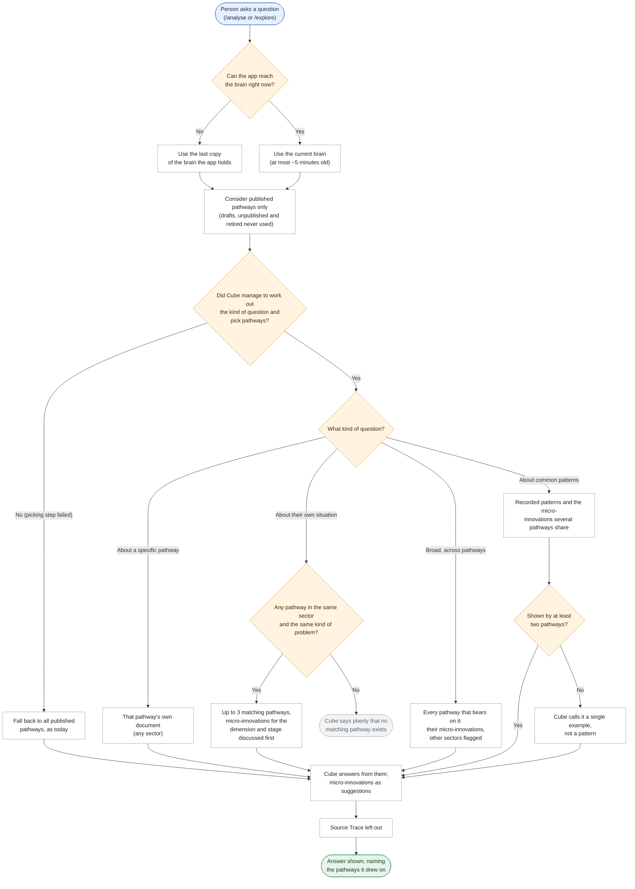
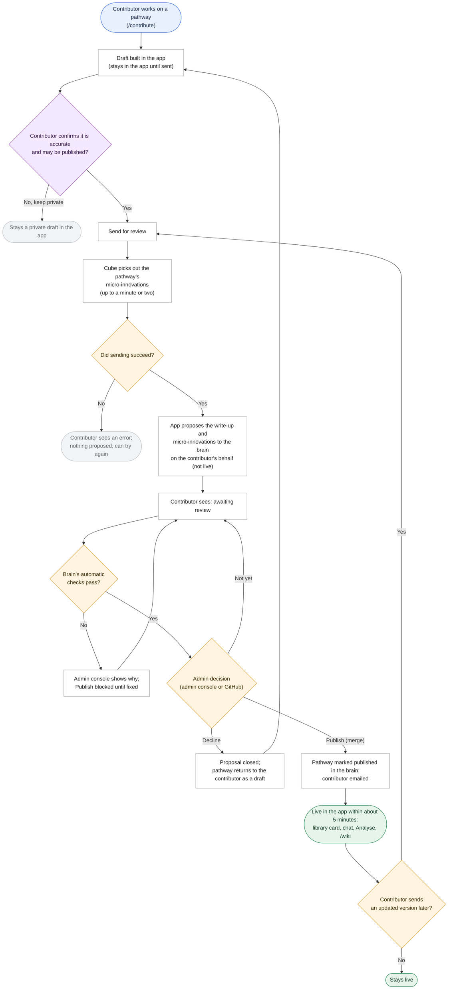
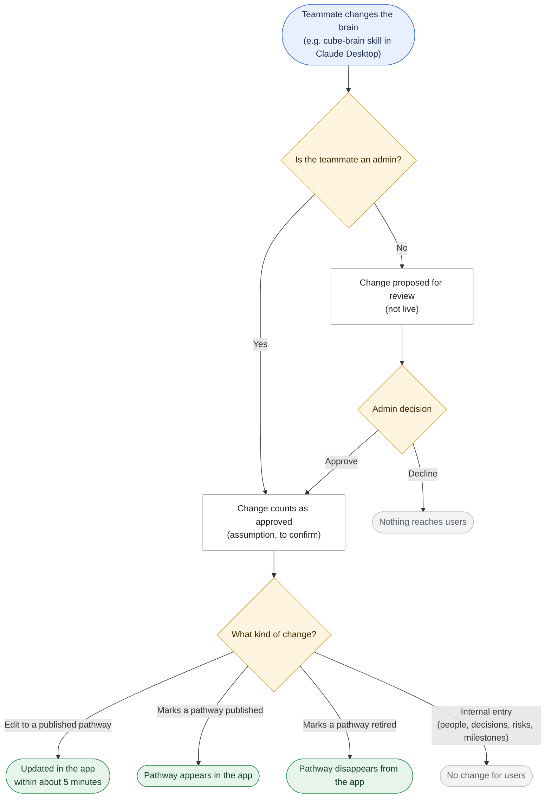
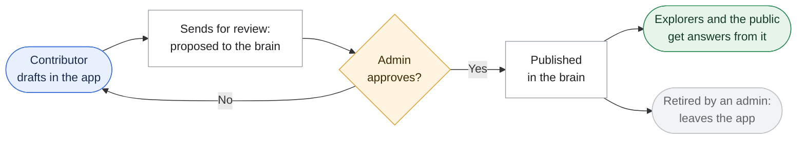

# Requirement: Cube-Brain as the Knowledge Source

**Source:** Requested by Anurag Goutam, 2026-10-30, because the assistant's answers are often not relevant. Partly covers the Product Charter backlog item "Corpus synthesis process (LLM Wiki approach)" (Functional, *Not started*). It is also groundwork for the **EkStep Contribution via Claude** milestone (15-Dec-26).

> Status: **Validated 2026-10-30** (business scope). **Must-have retrieval capabilities added 2026-10-30.** **Final scope 2026-10-30** after the architecture plan, see
> [`plan_cube_brain_knowledge_source.md`](plan_cube_brain_knowledge_source.md). Business clarifications are in
> [`business_clarifications_cube_brain_knowledge_source.md`](business_clarifications_cube_brain_knowledge_source.md);
> technical ones in [`architecture_clarifications_cube_brain_knowledge_source.md`](architecture_clarifications_cube_brain_knowledge_source.md).

## The problem today

People asking the assistant about their own AI adoption often get answers that are not about their situation.

In Analyse, the assistant is handed every pathway document in full on every turn, then left to find what matters. A single pathway runs to several thousand words, so the part that fits the person's sector and stage gets lost among the rest. In the public library, the assistant sees one pathway at a time. It cannot answer a question like "who else solved this at the Pilot stage?"

The knowledge also lives in three places that drift apart:

- the pathways that ship with the app
- the pathways admins publish into the app's database
- Cube-Brain, the team's project knowledge base

Cube-Brain is already the best organised of the three. Every pathway is broken into small, reusable pieces (micro-innovation units), each tagged with the dimension and stage it belongs to. But the app never reads it, and today it is behind the app.

## What we are building

1. **One knowledge source.** Cube-Brain becomes the single place pathway knowledge lives:
   - pathways in full, Source Trace included
   - their micro-innovation units and patterns
   - the organisations behind them

   The app's own database keeps app data only: users and roles, conversations, analysis documents, contributor workspaces and usage records.
2. **Answers built from what is relevant.** Before answering, the assistant works out what kind of question it is (a specific pathway, the person's own situation, a broad question, or common patterns: see "Must-have retrieval capabilities"), then picks the pathways to match. For the person's own situation that is at most 3, same sector and same kind of problem. It then reads their micro-innovations, the ones about what the person is discussing first, and the full write-up of the top 2. It does not read the whole corpus. If that picking step fails, it falls back to reading all published pathways, as it does today: less focused, but it never wrongly says nothing matches.
3. **Only published knowledge reaches users.** The app shows and uses a pathway only once it is marked published in the brain. Drafts, unpublished entries and retired pathways never appear.
4. **The library reads the brain too.** The `/explore` cards, the per-pathway library chat and the `/wiki` pages all come from the brain. A newly published pathway gets its library card automatically, with no code change.
5. **Sending for review opens a pull request.** A pull request is a proposed change to the brain that waits for approval. When a contributor clicks **Send for review**:
   - The app proposes the pathway to the brain this way on their behalf. The contributor never needs a GitHub account.
   - Along with the write-up, the app proposes the pathway's micro-innovations, which the assistant picks out automatically. This makes Send for review take up to a minute or two.
   - The pathway is not live yet.

   Sending an update while the earlier one is still waiting adds it to the same review instead of starting a new one.
6. **Merging is publishing.** When an admin approves (merges) the proposed change, the pathway goes live in the app within about 5 minutes.
   - The admin can approve from the admin console as today, or on GitHub; both count.
   - The brain checks every proposal automatically. If a check fails, the console shows why and Publish stays blocked until it is fixed.
   - The admin can also **Decline**: the proposal is closed and the pathway goes back to the contributor as a draft.
   - An updated version of a published pathway goes through the same review.
   - The contributor gets the same "your pathway is published" email as today, wherever the merge happened.
7. **Every edit needs an admin.** If a teammate edits the brain directly, for example through the `cube-brain` skill in Claude Desktop, the change reaches users only after an admin approves it. An admin's own direct change counts as approved (to confirm, see Assumptions).
8. **Retiring a pathway removes it.** When an admin-approved change marks a pathway retired in the brain, it disappears from the app: cards, library, chat and `/wiki`.
9. **The brain repository becomes private.** It will hold unapproved drafts and contributor-only Source Trace. Published pathways stay openly readable in the app's public library.
10. **The brain is brought up to date first.** Before the switch, the brain gets the app's current live pathways, 10 in all:
    - adding the 2 it lacks (Advanced Citizen Grievances System, Sahayak for Health)
    - refreshing the 2 that are out of date (CEEW Climate Intelligence, Data DHARA)
    - fixing its broken links

    That way users lose nothing on the day of the switch.
11. **Switch over safely.** The old way of answering stays available behind a switch. Each environment moves to the brain only after the ~20-question test set shows the brain-based answers are better. The dev app works against a separate `dev` copy of the brain, so test submissions never reach the real knowledge base.
12. **Admins can resync.** A **Resync from brain** button in the admin console makes the app pick up the latest brain content and the state of open reviews immediately, without waiting for the 5-minute refresh.

## Must-have retrieval capabilities

*Added 2026-10-30 by the requester as non-negotiable. Every release of this feature is judged against them (see the test set in Assumptions).*

1. **Specific answers from one pathway.** Cube must accurately retrieve specific information from individual pathways based on understood user intent.
   - *Example:* "How did MahaVISTAAR bring its cost per question down?" is answered from MahaVISTAAR's own document, precisely, even if the person works in another sector.
2. **Answers across pathways.** Cube must retrieve relevant answers across multiple pathways for broader user queries.
   - *Example:* "How have teams handled data governance with government partners?" draws on every pathway that documents it, not just the closest one, and says which pathway each point comes from.
3. **Common patterns.** Cube must identify and synthesize common patterns across multiple pathways for advanced insights.
   - *Example:* "What usually goes wrong at the Pilot stage?" brings together what several pathways show in common: the brain's recorded patterns and the repeated lessons in their micro-innovations. It names the pathways behind each pattern, and says plainly when only one pathway shows it.

How Cube does this: before answering, it first works out **what kind of question** this is:
- **about a specific pathway**;
- **about the person's own situation** (the default in Analyse);
- **a broad question across pathways**; or
- **a question about common patterns**.

It then picks the pathways and micro-innovations to match. It does this for every new message, so a new question never gets the previous question's pathways.

"Relevant" keeps its meaning. A pathway is presented as matching **the person's own situation** only if it is the same sector and the same kind of problem. Pathways reached through a specific, broad or pattern question can come from other sectors: Cube says so plainly in the same breath ("this is from agriculture, not health"), exactly as it already does for an adjacent match.

## How the assistant behaves

### Adopter side (Analyse and the public library)

- It draws only on **published** pathways and their units and patterns, plus the organisations named in them. It never uses the brain's people pages, internal decisions, risks or milestones.
- It first understands what the person is asking: about a specific pathway, about their own situation, a broad question across pathways, or about common patterns (see "Must-have retrieval capabilities"). It does this for every new message.
- **About their own situation:** a pathway counts as relevant only if it is the **same sector and the same kind of problem**, the same test as today.
- **About a specific pathway:** it answers from that pathway's own document, precisely, whatever its sector.
- **Broad:** it draws on every pathway that bears on the question, says which pathway each point comes from, and flags any from another sector.
- **Patterns:** it brings together what several pathways show in common. Each pattern names its pathways. A pattern seen in only one pathway is called a single example, not a pattern. Cube never invents a pattern the pathways don't show.
- Within the pathways it uses, it leans on the micro-innovations for the dimension and stage being discussed.
- Micro-innovations stay **suggestions** ("teams in a similar position have…"), never recommendations.
- **If nothing in the brain fits, it says so plainly.** It does not fill the gap with general AI advice. "No matching pathway" and "no matching micro-innovation" are reported separately, as today.
- Source Trace is **never** shown or quoted to an adopter, even though it now lives in the brain.

### Contributor side

- The drafting conversation is unchanged.
- The "a similar pathway already exists" check now compares against the brain's published pathways.
- After **Send for review**, the contributor sees that the pathway is awaiting review. They see it is live once an admin publishes it.

## Flow charts

### Adopter side (Question → Kind of question → Pathways and micro-innovations → Answer)

Updated 2026-10-30:
- The architecture plan adds a step that picks the pathways before answering. If that step fails, Cube falls back to all published pathways, as today, rather than wrongly saying nothing matches.
- "The current brain" means a copy at most about 5 minutes old.
- **Updated again 2026-10-30:** the picking step first works out the kind of question (specific pathway, own situation, broad, or patterns), so the three must-have capabilities are met. It runs for every new message.

#### How the pathways are picked

For every new message, Cube decides what kind of question it is, then picks:

| Kind of question | Example | What Cube reads | How it answers |
|---|---|---|---|
| About a specific pathway | "How did MahaVISTAAR cut its cost?" | That pathway's (at most 2) full documents, whatever their sector | Precisely, from the document |
| About their own situation | "We're starting voice advisory for farmers" | Up to 3 pathways in the same sector with the same kind of problem; full write-up of the top 2; micro-innovations for the cells discussed first | As today. If none matches, it says so plainly |
| Broad, across pathways | "How have teams handled data governance?" | Up to 6 pathways that bear on it, any sector; their micro-innovations on that topic first | Point by point, naming the pathway behind each and flagging other sectors |
| About common patterns | "What usually goes wrong at Pilot?" | The brain's recorded patterns across pathways, plus micro-innovations several pathways share | A pattern names its pathways; one seen in only one pathway is called a single example. Nothing invented |
| Picking step failed | (any) | All published pathways, as today | Less focused, never a false "nothing matches" |

### Contributor side (Draft → Consent → Send for review → Micro-innovations → Checks → Admin decision → Live)

Updated 2026-10-30: the architecture plan adds three things. Cube picks out the pathway's micro-innovations when it is sent for review. The brain's automatic checks must pass before Publish is allowed. "Live" now means within about 5 minutes. If sending fails (the assistant or GitHub is unavailable), nothing is proposed and the contributor can try again.

### Teammate and admin side (Direct edit → Approval → Live or Retired)

### End-to-end lifecycle

## Who it's for

- **Explorers (adopters) and public library visitors:** answers about their own situation, drawn from the pathways and micro-innovations that actually match it.
- **Contributors:** the same drafting experience. Their work enters the shared knowledge base once approved, with no GitHub account needed.
- **Admins (Program Team):** one approval step for everything that reaches users, whether it comes from a contributor or a teammate. They also get one place to retire a pathway.
- **The Solution and Program teams:** one knowledge base for the app, for the team's own questions through the `cube-brain` skill, and later for the Claude Chat channel.

## Assumptions

Questions the requester waived; each was decided as below and can still be changed.

1. **Success measure.** No examples of bad answers were available. The Solution and Program teams will write a test set of about 20 questions covering all four dimensions and four stages, then compare answers before and after the switch. The size and pass mark are still to be agreed. The current way of answering stays available until the brain-based answers are judged better. The test set must include questions for **each of the three must-have retrieval capabilities**: specific pathway, across pathways, and common patterns. Each capability has to pass on its own.
2. **Release scope.** No date is fixed. This release covers reading from the brain and publishing into it. Chatting with the brain from Claude Desktop / claude.ai is the next release.
3. **Surfaces.** Every place that shows knowledge reads the brain: Analyse, library chat, `/explore` cards, `/wiki`, and the contributor's similar-pathway check.
4. **What the assistant may use.** Published pathways, their units and patterns, and the organisations named in them. People pages, decisions, risks and milestones are internal and never used.
5. **Where admins approve.** The admin console stays the review place, and its Publish merges the change; merging on GitHub also counts. The Program Team members who publish need merge rights on the brain repository.
6. **Declining.** An admin can decline a proposal. The pathway returns to the contributor as a draft.
7. **Admin self-edits.** An admin's own direct change to the brain counts as approved, matching how an admin's own Publish works today.
8. **Removal.** Retiring is done by an admin-approved change in the brain. There is no new button in the admin console this release.
9. **Picking per message.** The picking step runs for every new message, because each question can be of a different kind. An analysis document or executive summary reuses the conversation's last "own situation" pick.
10. **Freshness.** An approved change is live within about 5 minutes. Today it is instant. Admins can force it sooner with Resync.
11. **Brain unreachable.** The app keeps answering from the last copy of the brain it holds, and users see no difference.
12. **First content.** Only the app's 10 currently live pathways are live on day one. The 6 pathways that exist only in the brain, the app's 2 unpublished drafts (Citizen Help, Community Health) and the test pathway `test-assets-langchat` stay unpublished unless an admin publishes them.
13. **Language.** English only, as today.

## Deliberately not included in this release

- **Chatting with the brain from Claude Desktop / claude.ai** (the Claude Chat channel). This is the next release and serves the 15-Dec-26 milestone.
- **Moving the framework definition into the brain.** The app's framework document controls how the assistant behaves, and the brain's framework pages are derived from it. Moving it does not improve relevance and adds risk, so it stays in the app for now.
- **Toolkit asset files.** The uploaded files stay in the app's storage; the brain links to them.
- **An admin-console button to retire a pathway.** Retiring happens in the brain for now.
- **Cross-pathway synthesised learnings** (the full "LLM Wiki approach" in the charter). The brain's units make this possible later, but it is not built here.
- **Future:** contributors seeing how often their pathway is reused (W5), and usage analytics. Both could later read from the brain.

## Trade-offs and risks, in plain terms

- **Relevance is the goal, but it is not guaranteed.** The switch gives the assistant less, better-chosen material. Whether answers actually improve has to be measured against the test set (Assumption 1), and the old way stays available until it is.
- **Publishing gets slightly slower.** It goes from instant to "within about 5 minutes" after approval. During those minutes, two people may briefly see different versions of the library. Send for review also takes up to a minute or two, because Cube picks out the micro-innovations.
- **Running cost stays about the same.** Measured on the dev app: an Analyse reply costs about $0.107 today, and is estimated at $0.08–0.095 after the change.
  - The general library chat goes from about $0.017 to about $0.03 per reply, because of the extra picking step.
  - Each Send for review adds about $0.17, once per submission.
  - Today every new pathway makes every Analyse reply more expensive; after the change the cost stays flat as the corpus grows.
- **Replies may start a second or two later** on every new message, because the picking step runs first. It runs for every message so that each question gets the right pathways (the three must-have capabilities). That costs about $0.0135 per message with the current model; it could be much less with a smaller one (see the plan).
- **Publishing gains a GitHub dependency.** Publishing, and new knowledge reaching users, depend on GitHub and on the app's access to the brain repository. If that access expires, users keep seeing the last copy, but nothing new can be sent for review or published until it is fixed.
- **The admins' tool partly changes.** The Program Team may need GitHub accounts and merge rights on a private repository.
- **The brain's own rules change.** It will hold full pathway text, and that has to be agreed with whoever owns the brain's conventions. Its validation rules also apply to every contributor's submission, so a submission that fails them cannot be published until it is fixed.
- **Making the repository private** means outside people can no longer read the brain or propose changes through forks. Only invited teammates and the app can.
- **Catching up first is a prerequisite.** If the switch happens before the brain matches the app, 2 live pathways would vanish for users and 2 would go back to older versions.
- **The Anthropic account behind every assistant feature** was due to expire on 28-Oct-2026 according to the charter, and that date has passed. Its renewal must be confirmed. The **AWS account** expires in December 2026.
